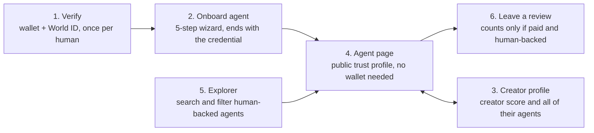

# Human-Backed Agent Reputation on Hedera — UI Elements

Nov 6, 2026

## Screen map and build order

The app has six screens. Three of them (Verify, Onboard agent, Agent page) are the whole demo path and get built first.

Build order:

1. Shared components (below), then Verify
2. Onboard agent
3. Agent page — milestone 6a, the demo path, is done here
4. Leave a review
5. Creator profile
6. Explorer

## Global elements

Every screen shares one header, one wallet button and one transaction-progress pattern, so a creator learns them once.

| Element | Where | Content and behaviour | Feature |
| --- | --- | --- | --- |
| Header bar | Top of every page | Product name (left); nav links Explore and My agents (My agents only when connected); primary button "Onboard agent"; wallet button (right) | — |
| Wallet button | Header, right | Disconnected: "Connect wallet". Connected: short address (`0x12…ab34`) plus a Verified creator badge if registered. Menu: copy address, view on HashScan, disconnect. | CR-1 |
| Network pill | Next to the wallet button | "Hedera Testnet" in neutral colour | CR-1 |
| Wrong-network banner | Full width under the header | "You're on \<network>. Switch to Hedera Testnet" plus a Switch button. Transaction buttons are disabled until switched. | CR-1 |
| Transaction progress | Inline under the button that started it, mirrored as a toast | Four states: Waiting for signature → Submitted (transaction ID link) → Confirmed (HashScan link) → or Failed (plain-language reason plus Retry) | — |
| Toasts | Bottom right | Success and info close after 5 seconds; errors stay until dismissed | — |
| Header search | Header, centre (Next) | Typing and pressing Enter opens Explorer with the query | DS-4 |
| Footer | Bottom of every page | Contract addresses with HashScan links (Identity, Reputation, CreatorRegistry, credential token), scores topic link, GitHub, and a "Testnet — no real value" note | DS-2 |

## Screen 1 — Verify (`/verify`)

The creator does this once: connect a wallet, prove they're a unique human with World ID, and leave with a creator record on Hedera.

| Element | Type | Content and behaviour | Feature |
| --- | --- | --- | --- |
| Step indicator | 3-step bar | Connect wallet · Verify with World ID · Done | — |
| Explainer | Text block | "One person, one creator. Your agents' reputation follows you." Plus a privacy line: "World ID proves you're unique without telling us who you are." | CR-2 |
| Connect wallet | Primary button | Shown only when disconnected | CR-1 |
| Wallet row | Address chip + text | "This wallet becomes your creator wallet", plus a "Use a different wallet" link | CR-3 |
| Verify with World ID | Primary button | Opens the IDKit modal: a QR code on desktop, a World App deep link on mobile | CR-2 |
| Progress | Status list | Verifying proof… → Registering on Hedera… (transaction link) → Done | CR-4 |
| Error: `ALREADY_REGISTERED` | Inline alert | "This World ID already has a creator wallet (0x12…ab34). Connect that wallet instead." | CR-3 |
| Error: `WALLET_TAKEN` | Inline alert | "This wallet already belongs to another creator." | CR-3 |
| Error: `INVALID_PROOF` / `WORLD_UNAVAILABLE` | Inline alert | "Verification didn't go through. Try again." plus a Retry button | CR-2 |
| Success | Card | Verified creator badge, creator wallet, HashScan link, and a primary button "Onboard your first agent" | CR-4 |
| Already verified | Redirect | A wallet that is already a creator skips straight to the success card | — |

## Screen 2 — Onboard agent (`/onboard`)

A five-step wizard that ends with a registered, linked agent holding its Human-backed credential, using two or three wallet signatures. Wallets that aren't verified are sent to Verify first.

| Step | Elements | Behaviour | Feature |
| --- | --- | --- | --- |
| 1. Details | Name (required, up to 50 characters), description (up to 280), image upload or URL, tag chips | Next is disabled until the name is filled | AG-1 |
| 2. Endpoints | A2A URL, MCP URL, website URL; x402 toggle with a price-per-call field (HBAR) | At least one endpoint is required; URLs are checked for format | AG-1 |
| 3. Agent wallet | Radio: "Use my creator wallet" (default) or "Use a separate agent account" (address field + "Sign with agent wallet") | The separate option calls `setAgentWallet` | AG-8 |
| 4. Review and register | Collapsible JSON preview, cost hint (about $0.02 plus $0.05 for association), "Register agent" button | Hosts the file, calls `register`, shows the new agent ID | AG-2, AG-3 |
| 5. Link and credential | Association check (✓ Associated, or an "Associate token" button), "Link to my creator identity" button, credential preview card | Calls `linkAgent`; the credential card appears when confirmed | AG-4–AG-6 |
| Success | Agent ID; buttons View agent page, HashScan (agent NFT, credential), Onboard another | — | DS-2 |

Across all steps:

- A progress bar showing the five steps
- Back and Next buttons
- A "Progress saved — you can come back later" note
- A resume banner on any page when the creator has a registered agent that isn't linked yet (AG-7)

## Screen 3 — Creator profile (`/creator/:address`)

Shows a creator's score, their penalties, and every agent they stand behind. The owner sees extra actions.

| Element | Type | Content and behaviour | Feature |
| --- | --- | --- | --- |
| Header | Address chip, Verified creator badge, "Creator since" date | Public | DS-3 |
| Creator score | Large score ring + tier badge | An info icon explains: "Average of your agents, capped at 100 minus penalties" | SC-5 |
| Penalties summary | Text + list | "−20 points, halving in 142 days"; each row shows date, agent, category, current points and a link to the reports | SC-4, SC-9 |
| Agents table | Table | Name, agent ID, score, tier, reviews counted, status (Active / Compromised / Operator changed), View link | DS-3 |
| Owner: Onboard agent | Primary button | Opens `/onboard` | AG-1 |
| Owner: Report compromised | Row action + confirm dialog | The dialog says: "Penalties after now will not count against you. This cannot be undone." | OP-2, SC-8 |
| Owner: Edit agent file | Row action | Opens the wizard prefilled | AG-9 |

## Screen 4 — Agent page (`/agent/:agentId`)

The public trust profile and the centre of the demo: anyone can see who stands behind an agent and why its score is what it is, with no wallet needed.

| Element | Type | Content and behaviour | Feature |
| --- | --- | --- | --- |
| Hero | Image, name, agent ID | Shows "Updated \<time>" from the latest snapshot | DS-1 |
| Score | Large score ring + tier badge | "New" label when the score is inherited from the creator | SC-2, SC-3, SC-6 |
| Human-backed badge | Badge | Or a warning banner: "Not linked to a verified human" | CD-3 |
| Creator card | Card | Creator address chip, creator score, link to the profile; an "Operator changed" note if the agent NFT was transferred | SC-5 |
| Trust breakdown | Stat row | Reviews counted, reviews excluded (expands to show the reasons), confirmed penalties | SC-1 |
| Credentials | Row of credential cards | Human-backed and milestone credentials; revoked ones are greyed out | CD-1–CD-6 |
| Endpoints | List | A2A, MCP, website, x402 price | AG-1 |
| Reviews | List of review cards | Filter tabs: All / Counted / Excluded / Misconduct; newest first | RV-1–RV-7 |
| Leave a review | Primary button | Disabled for the owner, with a tooltip explaining why | RV-4 |
| On-chain links | Link list | Agent NFT, agent file, latest score snapshot on HashScan | DS-2 |

## Screen 5 — Explorer (`/explore`)

Find agents worth hiring. The default view shows only human-backed agents.

| Element | Type | Content and behaviour | Feature |
| --- | --- | --- | --- |
| Stats strip | 4 numbers | Agents, human-backed agents, creators, reviews counted, from the latest snapshot | DS-4 |
| Search | Text field | Matches name, description and tags | DS-4 |
| Filters | Toggles + slider | Human-backed only (on by default), minimum score 0–100, tier chips, accepts x402 | DS-4 |
| Sort | Select | Score, Most reviewed, Newest | DS-4 |
| Results | Grid of agent cards | Image, name, small score ring, tier badge, Human-backed badge, creator score, review count | DS-4 |
| Empty state | Text + button | "No agents match. Try a lower minimum score." plus Reset filters | — |

## Screen 6 — Leave a review (modal on the agent page)

A paying client rates the agent. The form tells reviewers up front whether their review will count.

| Element | Type | Content and behaviour | Feature |
| --- | --- | --- | --- |
| Eligibility notice | Inline alert | If the wallet is not human-backed: "Your review will be recorded but won't count toward the score." plus a link to Verify | SC-1 |
| Payment | Select or paste | Recent transfers from this wallet to the agent wallet (from the Mirror Node), or paste a transaction ID; shows ✓ once verified | RV-5 |
| Rating | Slider 0–100 + quick picks | Quick picks: 100, 75, 50, 25, 0 | RV-1 |
| Type | Toggle | Quality / Misconduct. Misconduct shows a category select (fraud, failed settlement, other) and a note: "Counts against the creator once 2 creators confirm." | RV-3 |
| Category | Select | Accuracy, speed, uptime, communication | RV-1 |
| Endpoint used | Select | From the agent's endpoints | RV-1 |
| Comment | Text area | Up to 500 characters, with a counter | RV-2 |
| Submit | Transaction button | Uploading review… → Sign `giveFeedback` → Confirmed | RV-1, RV-2 |

## Shared components

Build these ten components first. The six screens above are mostly arrangements of them.

| Component | Looks like | Used on | Notes |
| --- | --- | --- | --- |
| Score ring | Circular gauge 0–100 with the number in the middle | Agent page (large), creator profile (large), cards (small) | Colour by tier |
| Tier badge | Pill: Tier 1 / Tier 2 / Tier 3 / New | Everywhere a score appears | Tier 1 green, Tier 2 neutral, Tier 3 amber, New grey |
| Human-backed badge | Shield icon + "Human-backed" | Agent page, cards, review cards | Tooltip: "Linked to a unique World ID–verified creator"; links to the credential on HashScan |
| Verified creator badge | Check icon + "Verified creator" | Wallet button, creator profile | — |
| Credential card | Small ID-style card: title, issuer, issue date, serial, lock icon "Non-transferable", status | Agent page, onboarding success | Revoked = greyed out with a "Revoked" label |
| Review card | Reviewer chip + badge, value (number + bar), tag chips, comment, date, payment ✓ / ✗, Counted or Excluded label with reason | Agent page | The agent's response is indented below; links to HashScan and the HCS file |
| Address chip | `0x12…ab34` + copy icon + HashScan icon | Everywhere | Hover shows the Hedera account ID (0.0.x) |
| Transaction button | Button with built-in states | Every on-chain action | Idle → Waiting for signature → Submitted → Confirmed / Failed |
| Cost hint | Small grey text "≈ $0.02 network fee" | Next to transaction buttons | From a fixed table; refresh before mainnet |
| Empty state | One line + one action | Lists and grids | No illustrations needed |

## States

Every screen handles these states. The two most often missed are Mirror Node lag and a wallet rejection.

| State | Where | What the user sees |
| --- | --- | --- |
| Loading | Cards, tables, agent page | Skeleton blocks; no full-page spinners |
| Confirming (Mirror Node lag) | After any transaction | "Confirming on Hedera — usually a few seconds" with the transaction link. Polls every 2 seconds; after 30 seconds: "Taking longer than usual" plus Refresh |
| Signature rejected | Any transaction button | "Cancelled in your wallet" plus Retry; the form keeps its values |
| Transaction failed | Any transaction button | A plain-language reason (e.g. not enough HBAR → "Top up from the testnet faucet") plus the HashScan link |
| Wrong network | Global | Full-width banner; transaction buttons disabled |
| Not verified | `/onboard`, review modal | Onboard: a gate card "Verify with World ID first". Review: the eligibility notice |
| Empty | Explorer, reviews, agents table | "No reviews yet. Pay this agent, then be the first to review." |
| Stale scores | Agent page, explorer | Amber chip "Scores last updated \<time>" when the snapshot is 2+ epochs old |
| Agent not linked | Agent page | Warning banner "Not linked to a verified human"; score shown with the warning |
| API down | Any data view | Inline error plus Retry; on-chain HashScan links stay visible |
